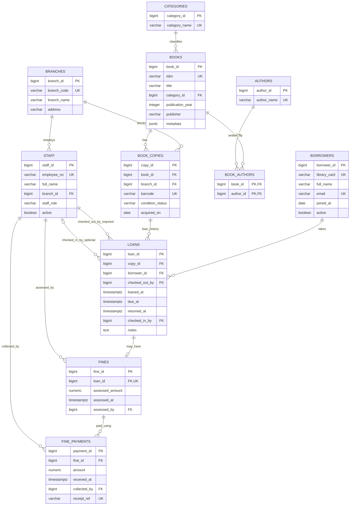

# Crescent City Library — ER diagram

The diagram reflects the **tables and attributes in `01_schema.sql`**. It is a model, **not evidence of execution**. `checked_out_by` and `checked_in_by` are deliberately shown as separate STAFF relationships. Foreign keys are listed by their actual names in LOANS.

**Cardinality notes:** a loan has exactly one checkout staff member, but the check-in staff member is `NULL` until the book is returned. One loan can have zero or one fine (`fines.loan_id` is UNIQUE); one fine can have multiple payments. The unique *partial* index on `loans(copy_id)` where `returned_at IS NULL` enforces at most one simultaneous unreturned loan per copy, which ordinary ER cardinality notation does not express.
