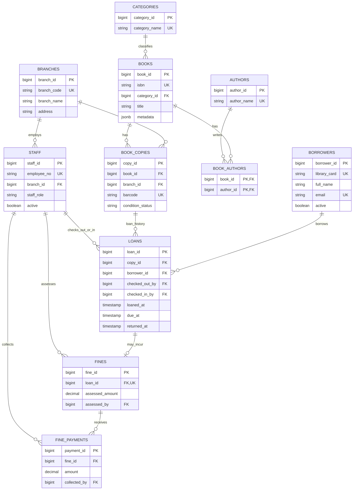

# Entity–relationship diagram — Crescent City Library

This Mermaid ER diagram is rendered directly by GitHub. It documents the schema in `01_schema.sql` (not an execution screenshot).

**Key modelling decision:** a `BOOK` is a bibliographic title, while a `BOOK_COPY` is an individual physical item. The same title can have many independently loanable barcoded copies. A partial unique index enforces at most one open loan per copy. A loan can have zero or one fine; a fine can be paid in several instalments.

**Diagram limitation:** the notation combines both staff foreign keys in `LOANS` for readability; there are two separate relationships, `checked_out_by` (required) and `checked_in_by` (nullable until returned). Confirm the exact design against the SQL schema.